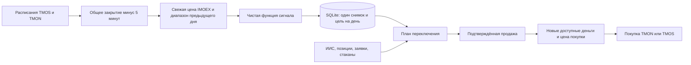

# План разработки TMOS ↔ TMON на ИИС Т-Инвестиций

## 1. Требования, принятые в этой версии

| Параметр | Решение |
|---|---|
| Счёт | Конкретный существующий ИИС, закреплённый через `TINVEST_ACCOUNT_ID` |
| Пара | TMOS / TMON; другие бумаги не продаются |
| Сигнальный инструмент | IMOEX, как в исходной проверке стратегии |
| Момент проверки | За пять минут до конца последней общей сессии двух фондов |
| Ниже минимума предыдущего дня | Перейти в TMON |
| Выше максимума предыдущего дня | Перейти в TMOS |
| Внутри диапазона, включая равенство | Сохранить предыдущую целевую позицию |
| Частота решения | Один зафиксированный снимок на торговый день |
| Исполнение | Продажа → подтверждение → пересчёт денег → покупка |
| Кредит / шорт / фьючерсы | Не используются |
| Свободные деньги | Без автоматического инвестирования, пока это отдельно не включено |
| Текущая поставка | Рабочий каркас наблюдения и планирования, без выставления заявок |

«За пять минут до конца» заменяет прежнюю идею проверять после закрытия каждой
сессии. При наличии вечерних торгов берётся общая вечерняя сессия. При разных
расписаниях — последний интервал, когда доступны оба фонда. Выходные и особые
режимы определяются расписанием, а не календарём понедельник–пятница.

Окно решения начинается в `session_end − 5 минут`. Скелет допускает задержку
запуска до 60 секунд; первый валидный снимок фиксируется навсегда на этот день.
Повторные проверки не меняют уже сохранённое решение. Если нужен непрерывный
пересчёт сигнала до последней минуты, это будет отдельным изменением стратегии.

## 2. Что изменилось относительно бэктеста

1. **TMON вместо LQDT.** Нужно использовать реальную историю TMON; результаты
   LQDT не доказывают доходность TMON. Если истории недостаточно, сокращается
   проверяемый период, а не подставляется другой фонд под тем же названием.
2. **Текущая цена до закрытия вместо фактического close.** За оставшиеся минуты
   цена может вернуться в диапазон. Нужен тест на внутридневных данных с такой же
   точкой времени и правилами исполнения. Старые 22,87% к этой версии не относятся.
3. **Реальные две заявки вместо условной одновременной сделки по OPEN.** Между
   продажей и покупкой возникает временная денежная позиция. Нужно учитывать
   частичные исполнения, доступный денежный лимит, спред и смену сессии.
4. **Источники realtime.** Скелет не предполагает, что IMOEX доступен в T-Invest
   как обычный торгуемый инструмент. Предыдущий диапазон берётся из MOEX ISS;
   пригодность текущего IMOEX для T−5 нужно подтвердить отдельно.

## 3. Архитектура



До E включительно и подготовка F реализованы. Узлы H–J пока представлены
интерфейсом: сетевой вызов `PostOrder` отсутствует.

### Разделение состояния

- **Цель стратегии:** последний принятый сигнал TMOS/ТMON. Она может отличаться
  от текущих позиций при задержке исполнения.
- **Фактический портфель:** источник истины — брокер, не локальный JSON.
- **Намерение:** торговая дата, источник сигнала, цена и время, предыдущие high/low,
  цель и UUID, записанные до попытки выставить заявку.
- **Заявки:** собственные client IDs и биржевые IDs, стороны, объёмы, частичные
  исполнения и причины отмены. Эта таблица добавляется на этапе исполнения.

При перезапуске сначала восстанавливаются заявки и реальные остатки, затем
принимаются новые действия. Сохранённая цель сама по себе не подтверждает сделку.

## 4. Этапы разработки

### Этап A. Проверить инструменты, время и данные

Работы:

- Подключить read-only токен конкретного ИИС; проверить открытый статус счёта.
- Найти точные TMOS и TMON, подтвердить `for_iis_flag`, API-доступность, валюту,
  UID/FIGI, лот, минимальный шаг цены и торговую площадку. Не зашивать UID вручную.
- Снять реальные ответы `TradingSchedules`, `GetTradingStatus`, `GetOrderBook`,
  `GetPositions`. Сохранить обезличенные контрактные примеры для тестов.
- Подтвердить, что выбранное последнее общее закрытие соответствует желаемому
  «концу дня», в том числе в особые торговые дни. Часовой пояс — UTC внутри,
  Europe/Moscow для биржевой даты. Синхронизация системных часов обязательна.
- Измерить задержку IMOEX в точке проверки. Проверять биржевое время цены,
  не время HTTP-ответа. При задержке нужен подтверждённый realtime-провайдер.
  Замена IMOEX на TMOS не делается молча: она требует отдельного теста.
- Проверить, какой период покрывают high/low предыдущей дневной свечи IMOEX:
  он должен быть одинаковым в истории и текущем алгоритме.
- Если T−5 попадает в аукцион, определить способ исполнения: две обычные
  последовательные заявки могут не успеть исполниться до общего закрытия.
  Скелет помечает аукцион блокирующей причиной, а не считает его обычными торгами.

Готово, когда: в журнале за несколько разных торговых дней видно корректное
время проверки и свежий IMOEX; оба фонда найдены однозначно и доступны на ИИС.
Ни одной реальной заявки на этом этапе.

### Этап B. Перепроверить именно TMOS/TMON и T−5

Работы:

- Собрать минутные данные IMOEX, TMOS и TMON и календарь сессий.
- На каждом дне взять только информацию, известную к T−5; предыдущий диапазон
  должен принадлежать полностью завершённому торговому дню.
- Сигнал формировать в T−5, исполнение моделировать после него. Не покупать
  по уже прошедшему OPEN и не использовать финальное закрытие вместо снимка.
- Сравнить: накопление TMOS, накопление TMON, переключение пары; использовать
  одинаковые взносы и одинаковый период доступной истории.
- Сначала повторить идеальный сценарий с нулевой комиссией, затем добавить
  спреды, проскальзывание, реальную доступность объёма, задержку двух операций
  и лимит бесплатных заявок. Внутренние расходы фондов уже содержатся в цене.

Готово, когда: есть воспроизводимый отчёт по новой версии стратегии и проверка
без использования будущих данных. Это не требует оптимизации параметров.

### Этап C. Довести наблюдение до постоянной работы

Работы:

- Кешировать UID/лоты/площадки, регулярно обновлять расписание текущего дня.
  Непосредственно перед исполнением всегда перечитывать торговый статус.
- Добавить ограниченные повторы читающих запросов при 429, 5xx и timeout,
  deadline и backoff. Выйти из проверки, если окно сигнала уже пропущено.
- Добавить журнал свежести данных, дрейфа часов, блокирующих причин и heartbeat.
- Собирать ежедневные снимки минимум несколько недель и сравнивать с ручной
  проверкой и offline-расчётом. SQLite исключает дубли при перезапуске/конкуренции.
- Обновления конфигурации/версии стратегии проводить между торговыми днями;
  не создавать второе решение сменой настройки внутри того же дня.

Готово, когда: после рестартов, выходных, недоступности API и задержек данных
бот не теряет цель и не создаёт дублирующих решений.

### Этап D. Реализовать автомат исполнения через fake broker

До подключения торгового API нужно реализовать и проверить переходы:

```text
DECISION_SAVED → EXIT_PENDING → EXIT_PARTIAL → EXIT_FILLED
    → WAIT_AVAILABLE_CASH → ENTRY_PENDING → ENTRY_PARTIAL → DONE

Дополнительно: REJECTED / CANCEL_PENDING / EXPIRED / UNKNOWN / NEEDS_RECONCILIATION
```

Основные правила:

- Сначала проверить актуальные остатки и заявки пары. Ручные действия
  пользователя во время переключения должны быть обнаружены и согласованы
  с уже отправленными объёмами.
- Сохранить client ID и параметры ноги в SQLite **до** сетевого запроса.
  Биржевой ID хранить отдельно: он отличается от client key.
- Продать только собственные доступные целые лоты исходного фонда.
  Непроданные остатки и заблокированные бумаги не считать проданными.
- После подтверждения перечитать позиции/денежные лимиты и рассчитать покупку.
  `PostOrder` с ответом «принято» не равен подтверждению полной продажи.
  Для счёта с другими позициями учитывать их блокировки: `GetPositions` не
  показывает деньги под ГО сторонних фьючерсов; доступный лимит нельзя считать
  просто рублёвым остатком без проверки других обязательств и методов лимитов.
- Сумму покупки ограничить фактическими доступными деньгами, резервом и
  подтверждённой выручкой. Чужие свободные деньги не расходовать при
  `invest_idle_cash=false`. Не включать маржинальное подтверждение.
- Использовать лимитную заявку с ограниченным отклонением от свежего стакана,
  лотностью и шагом цены. Проверить доступные `time_in_force` для режима торгов.
- При частичном исполнении ограничить повтор суммой оставшихся лотов.
  При отмене сначала подтвердить итоговое состояние и поздние сделки.
- После timeout считать результат неизвестным: искать заявку по сохранённому
  client ID, а не отправлять новую с новым ID. Ошибку дубликата тоже сначала
  сверять с брокером. Не полагаться только на срок хранения ключей у API.
- Определить deadline двух ног до окончания доступных торгов. Если продажа
  произошла, а покупка нет, сохранить денежную позицию и точную фазу. Политику
  возобновления покупки в следующей сессии реализовать явно; новый дневной
  сигнал не должен забыть или продублировать незавершённую операцию.

Готово, когда: тесты fake broker проходят сценарии частичного исполнения,
отказа второй ноги, потери ответа на отправку, рестарта между ногами,
двух процессов и ручного изменения позиций.

### Этап E. Интеграция с песочницей

- Добавить отдельный sandbox-адаптер и отдельную базу; не переиспользовать
  рабочий номер ИИС и состояние production.
- Прогнать весь автомат через `PostSandboxOrder`/чтение состояний.
- Учитывать, что песочница проверяет API-контракт и логику, но не доказывает
  реальную ликвидность, правила ИИС и качество исполнения на аукционе.

Готово, когда: реальные ответы песочницы подтверждают корректность client IDs,
лотов, цен и восстановления состояния после потери соединения.

### Этап F. Подключение реального исполнения

- Добавить отдельный production-адаптер вместо текущего read-only transport.
  Нельзя расширять allowlist наблюдателя незаметно.
- Настроить токен только нужного ИИС, управляемую долю пары, максимальный
  оборот/число попыток, остаток рублей и остановку исполнения.
- Сверить реальные комиссии и лимиты бесплатных сделок; настройки бэктеста
  с нулевой комиссией не являются подтверждением тарифа реального счёта.
- Провести первые переключения на ограниченном объёме с сопоставлением
  журнала бота, заявок и брокерского отчёта.

Готово, когда: цикл двух ног подтверждён фактическими исполнениями, а
неполадки приводят к сохранённому понятному состоянию, а не к повторной продаже.

### Этап G. Развёртывание и сопровождение

- Выделить непрерывно работающий Linux-хост, отдельного пользователя службы,
  секреты вне репозитория и доступную для записи папку состояния.
- Установить timer/service из `deploy/`, настроить абсолютные пути и
  `state_file=/var/lib/tmos-tmon-bot/state.sqlite3` для такого развёртывания.
- Логи: время/цена/предыдущий диапазон/цель/intent ID/фаза/причина пропуска;
  токены и полный номер счёта не логировать.
- Организовать резервное копирование SQLite штатным backup API, проверку
  восстановления и запрет одновременного использования старого и нового хоста.
- Зафиксировать процедуру остановки: запрет новых переключений отдельно
  от отмены уже отправленных заявок; затем сверка реального портфеля.

Готово, когда: наблюдение и восстановление проверены после перезапуска хоста,
смены дня, временного отказа сети и обновления приложения.

## 5. Что поставлено сейчас

| Область | Статус |
|---|---|
| Сигнал IMOEX в T−5 | Реализован как чистая функция |
| Общее расписание, вечерние сессии | Реализовано, проверено синтетическими ответами |
| SQLite и одно решение в день | Реализовано |
| Читающие REST-адаптеры | Реализованы; интеграция с пользовательским ИИС не запускалась |
| Freshness / ИИС / заявки / позиции | Реализованы основные проверки |
| План продажи и отложенного расчёта покупки | Реализован |
| Live/sandbox отправка и восстановление заявок | Интерфейс и план, без реализации |
| Новый intraday-бэктест TMOS/TMON | Следующий исследовательский этап |
| Постоянная служба | Шаблоны, не установлены |

## 6. Официальные источники

- [Работа с поручениями и различие client/exchange order ID](https://developer.tbank.ru/invest/services/orders/head-orders)
- [FAQ: идемпотентность и лоты](https://developer.tbank.ru/invest/services/orders/faq_orders)
- [PostOrder: лимитная цена, quantity в лотах, confirmMarginTrade](https://developer.tbank.ru/invest/api/orders-service-post-order)
- [Расписания и торговые статусы](https://developer.tbank.ru/invest/services/instruments/head-instruments/)
- [Торговые площадки, сессии и изменение расписаний](https://developer.tbank.ru/invest/intro/useful-info/markets)
- [GetPositions как источник актуальных остатков](https://developer.tbank.ru/invest/services/operations/head-operations)
- [Protobuf: TradingDay, Instrument, InstrumentShort](https://github.com/Tinkoff/investAPI/blob/main/src/docs/contracts/instruments.proto)
- [Protobuf: Account и тип ИИС](https://github.com/Tinkoff/investAPI/blob/main/src/docs/contracts/users.proto)
- [Protobuf: свободный balance и blocked](https://github.com/Tinkoff/investAPI/blob/main/src/docs/contracts/operations.proto)
- [Protobuf: стакан, время orderbook_ts и торговые статусы](https://github.com/Tinkoff/investAPI/blob/main/src/docs/contracts/marketdata.proto)
- [MOEX ISS: предыдущие дневные свечи IMOEX](https://iss.moex.com/iss/engines/stock/markets/index/boards/SNDX/securities/IMOEX/candles.json?interval=24)

Схемы и описания проверены при подготовке скелета 31.10.2026. Перед
подключением исполнителя нужны актуальные контрактные проверки API.
